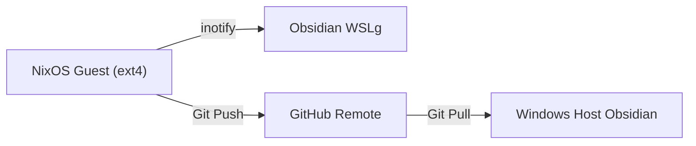
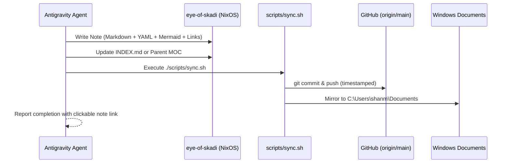

# Obsidian Vault Curator (Eye of Skadi)

> *"The user is the observer, reader, and consumer. The agent is the architect, visual illustrator, and autonomous vault curator."*

Use this skill whenever working on systems architecture, making non-trivial technical choices, solving tricky bugs, exploring concepts, or capturing persistent knowledge.

---

## 🏛️ Core Principles

1. **Config-Driven & Zero Friction**:
   - The user never needs to manually write, copy-paste, or format notes.
   - The agent autonomously captures, structures, illustrates, and persists knowledge directly into `eye-of-skadi`.
   - Never ask "Would you like me to write a note about this?" for significant technical decisions or architecture milestones—execute the note creation autonomously.

2. **Visual Art & High Information Density**:
   - Every note is designed to be visually compelling and immediately readable in Obsidian.
   - Avoid plain walls of text. Every note MUST integrate visual anchors:
     - **Mermaid Diagrams**: System topology (`flowchart LR`/`TD`), protocol cycles (`sequenceDiagram`), or states (`stateDiagram-v2`).
     - **Visual Callouts**: Standardized Obsidian callout blocks (`[!NOTE]`, `[!TIP]`, `[!IMPORTANT]`, `[!WARNING]`, `[!ABSTRACT]`, `[!EXAMPLE]`).
     - **Structured Tables**: Side-by-side metric comparisons, schemas, and option trade-offs.
     - **ASCII / Unicode Architecture**: Compact layout blocks for memory layouts, CLI flags, or filesystems.

3. **Interconnected Knowledge Graph**:
   - No orphan notes. Every note must link back to `[[INDEX]]` (the Master Map of Content) and at least 2 contextually related notes (`[[Related Note]]`).
   - Use standard `[[WikiLinks]]` with human-readable anchors where necessary (`[[Note#Heading|Label]]`).

4. **Automated Dual-Sync**:
   - After creating or significantly updating notes in `/home/damathryxx64/repositories/eye-of-skadi/`, automatically trigger `/home/damathryxx64/repositories/eye-of-skadi/scripts/sync.sh`.
   - This commits and pushes updates to GitHub (`origin/main`) and mirrors notes to the local Windows Documents directory (`C:\Users\shanm\Documents\eye-of-skadi\`).

---

## 📂 Vault Hierarchy

```text
eye-of-skadi/
├── INDEX.md                 # Master Map of Content (MOC)
├── knowledge/               # Deep conceptual documentation and architectural guides
├── systems/                 # NixOS, WSL2, Linux kernel, and host bridge architecture
├── agent-memory/            # Learned facts, user preferences, and persistent memory
├── journal/                 # Chronological session decisions and milestone logs
├── templates/               # Standardized templates for new records
└── scripts/                 # Sync and launcher automation scripts
```

---

## 📝 Note Frontmatter Schema

All notes must begin with strict YAML frontmatter:

```markdown
---
title: Note Title
tags:
  - systems        # or knowledge, memory, journal, architecture
  - topic-keyword
type: architecture | conceptual | decision | memory | reference
created: YYYY-MM-DD
updated: YYYY-MM-DD
---
```

---

## 🎨 Visual Elements Guide

### 1. Obsidian Callouts
Use callouts strategically to structure reading hierarchy:

```markdown
> [!ABSTRACT] Executive Summary
> High-level summary of what this note defines and why it matters.

> [!NOTE] Background Context
> Relevant architectural history, constraints, or prerequisite concepts.

> [!TIP] Best Practice & Rule
> The proven or optimal path forward.

> [!IMPORTANT] Critical Requirement
> Invariants that must never be broken.

> [!WARNING] Breaking Change / Edge Case
> Suble traps, upstream bugs, or compatibility gotchas.
```

### 2. Mermaid Diagrams
Ensure syntax complies with Obsidian's Mermaid engine:

```markdown

```

### 3. Metric & Comparison Tables
Always format markdown tables cleanly with aligned pipes and headers:

| Component | Target Runtime | Inotify Support | Latency |
|---|---|---|---|
| **Linux Obsidian** | WSLg (NixOS) | Native kernel (`inotify`) | < 1ms |
| **Windows Obsidian** | Windows Host (`C:\`) | Native Windows I/O | < 1ms |

---

## 🔄 Autonomous Note Creation Workflow

When a milestone is reached or a key insight is established:


